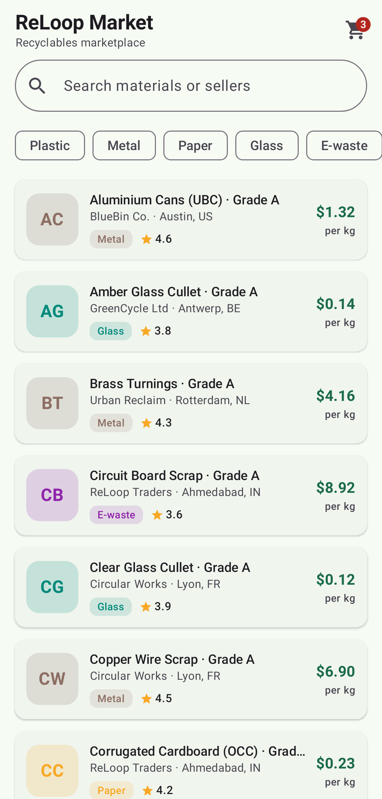
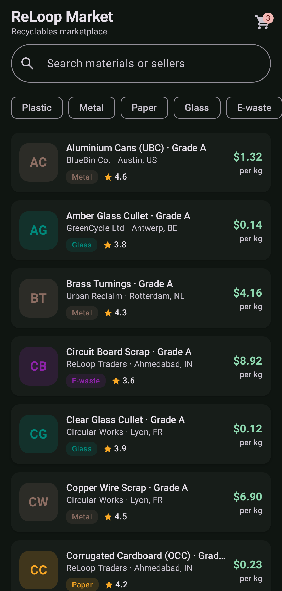
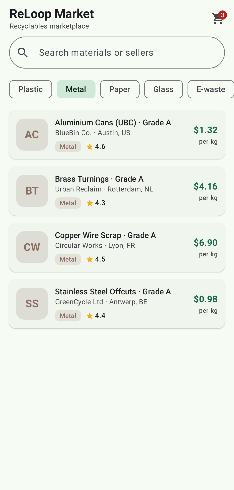
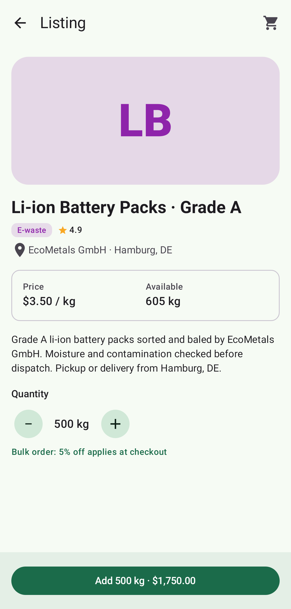
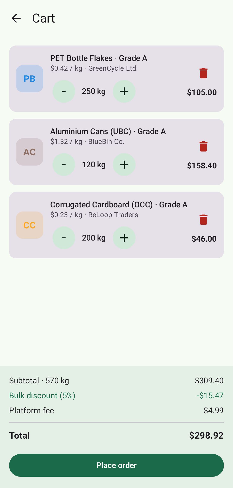
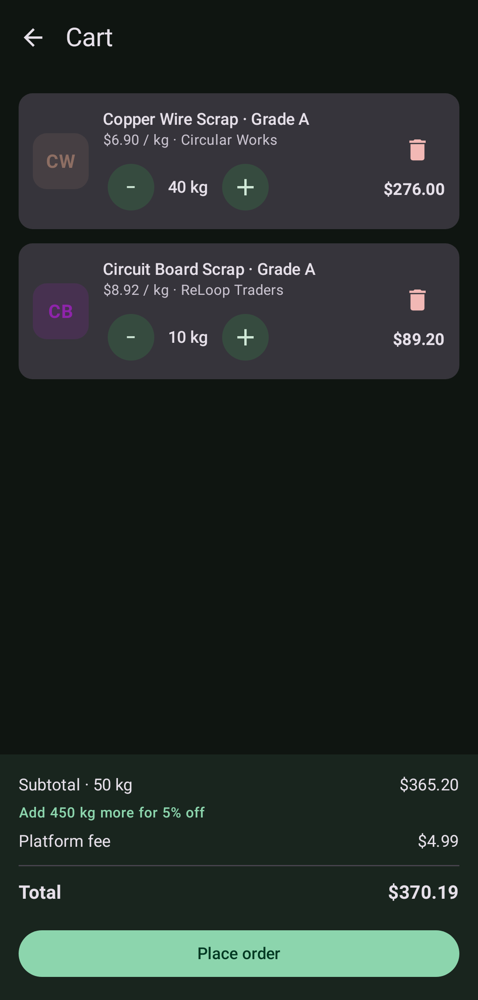
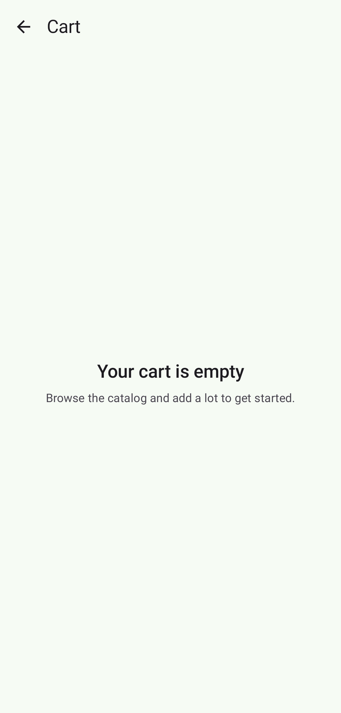
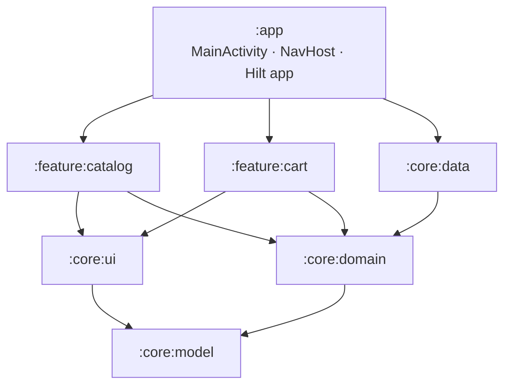

# ReLoop Market · Jetpack Compose marketplace

[](https://github.com/gayatripatel10091992/compose-marketplace/actions/workflows/ci.yml)


A recyclables marketplace demo app (browse material lots, filter, view a listing, build a cart with bulk pricing).
It shows how I structure production Android apps: **multi-module Clean Architecture, MVVM, Hilt, Paging 3 over Room,
type-safe Navigation, and screenshot tests that run on the JVM in CI.**

> Portfolio project. All data is generated locally; no client code or proprietary APIs are used.

## Screenshots

Generated by CI on every push to `main` (Robolectric + Roborazzi), so they always match the code.

| Catalog | Dark mode | Category filter |
|---|---|---|
|  |  |  |

| Listing detail | Cart with bulk discount | Cart (dark) | Empty cart |
|---|---|---|---|
|  |  |  |  |

## Architecture



| Module | Type | Responsibility |
|---|---|---|
| `:core:model` | Kotlin/JVM | Pure models and pricing rules (`CartSummary`), fully unit-tested |
| `:core:domain` | Kotlin/JVM | Repository interfaces and use cases. No Android dependencies |
| `:core:data` | Android library | Room database, DAOs, `PagingSource`, repository implementations, Hilt bindings |
| `:core:ui` | Android library | Material 3 theme and shared components |
| `:feature:catalog` | Android library | Search + category filter list (Paging 3), listing detail |
| `:feature:cart` | Android library | Cart, quantity changes, bulk discount, checkout |
| `:app` | Application | Wires the feature navigation graphs together |

**Key decisions**
- **Feature modules never depend on each other.** Each exposes a `NavGraphBuilder` extension and a type-safe route; `:app` connects them.
- **Unidirectional data flow.** ViewModels expose `StateFlow`; screens are split into a stateful `Route` and a stateless `Screen`, which is what the screenshot tests render.
- **Paging 3 over Room.** Search is debounced (`debounce` + `flatMapLatest`) and the paged flow is `cachedIn(viewModelScope)` to survive configuration changes.
- **Money in minor units.** Prices are `Long` cents, so there are no floating-point rounding bugs.
- **Safe concurrent writes.** Cart increments are a single Room `@Transaction`, so rapid taps never lose an update.

## Tech stack

Kotlin · Coroutines & Flow · Jetpack Compose · Material 3 · Navigation Compose (type-safe) · Hilt · Room · Paging 3 ·
kotlinx.serialization · JUnit · Robolectric · Roborazzi · GitHub Actions · Dependabot

## Run it

```bash
./gradlew :app:installDebug             # run on a device/emulator
./gradlew :core:model:test :core:domain:test   # unit tests
./gradlew recordRoborazziDebug          # regenerate screenshots locally
```

Requires JDK 17 and Android Studio Ladybug or newer.

## CI

`.github/workflows/ci.yml` runs unit tests, builds debug + minified release APKs, records screenshots,
uploads the APKs as build artifacts and commits refreshed screenshots back to `docs/screenshots`.

## License

MIT © Gayatri Patel
